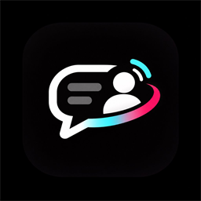
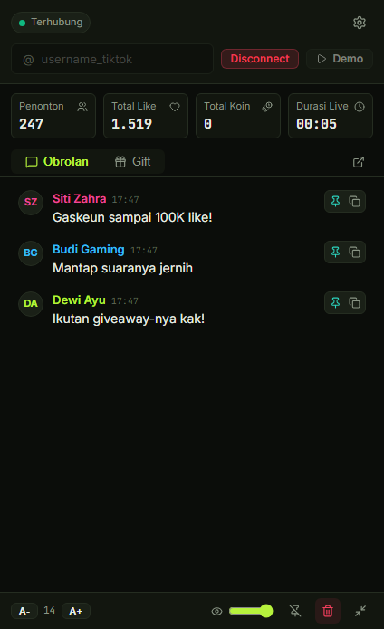
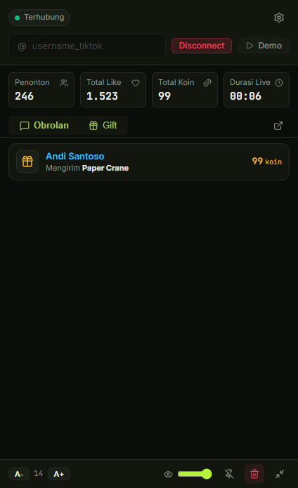
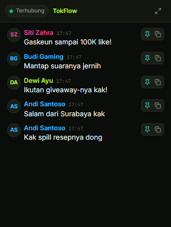
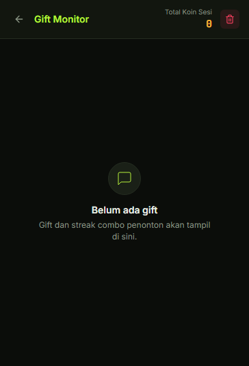
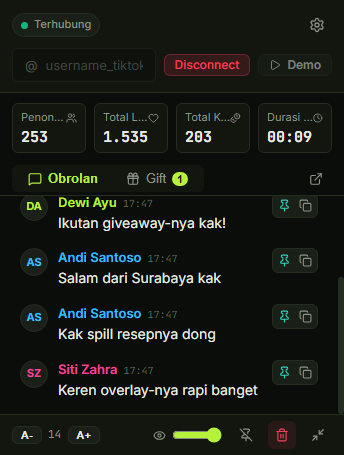
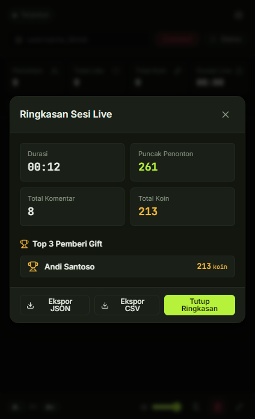

# TokFlow ⚡

<p align="center">
  
  <br />
  <strong>Sahabat Terbaik Streamer TikTok Live di Windows</strong>
</p>

Aplikasi desktop Windows yang **ringan**, **aman**, dan **rapi** untuk streamer TikTok Live, dirancang khusus agar tetap lancar di PC berspesifikasi rendah hingga menengah.

Menampilkan obrolan, gift, jumlah penonton, dan like secara realtime, lengkap dengan overlay transparan siap pakai untuk OBS Studio.

---

## 📸 Tangkapan Layar Aplikasi

| Jendela Utama (Demo 440x760) | Tab Gift & Combo | Mode Mini (360x520) |
|:---:|:---:|:---:|
|  |  |  |

| Pop-out Gift Monitor | Pengaturan (Drawer) | Ringkasan Sesi |
|:---:|:---:|:---:|
|  |  |  |

---

## 🌟 Fitur Utama

- **Ringan & Hemat Daya:** Dibangun menggunakan Preact dan arsitektur multi-proses terpisah, menjaga konsumsi RAM dan CPU tetap minimal saat streaming.
- **Dapat Dipercaya:**
  - **Viewer Resolver Multi-Sumber:** Menggabungkan event room, join member, dan polling informasi ruangan secara cerdas dengan perlindungan lonjakan (spike guard).
  - **Gift & Combo Tracking:** Pelacakan combo gift akurat berbasis delta koin tanpa duplikasi saat streak berlangsung.
- **Aman Sejak Awal:**
  - Server overlay OBS terikat eksklusif ke `127.0.0.1` dengan proteksi token acak 32 heksadesimal dan pencegahan DNS rebinding.
  - CSP ketat, isolasi konteks penuh, tanpa `eval`, dan tanpa telemetri pihak ketiga.
- **Tampilan OBS Siap Pakai:** Halaman overlay transparan dengan koneksi Server-Sent Events (SSE) yang otomatis pulih jika terputus.
- **Jendela Fleksibel:**
  - Jendela utama dengan tab Chat dan Gift yang rapi.
  - Mode Mini ringkas untuk menghemat ruang monitor.
  - Pop-out Gift Monitor terpisah dengan sinkronisasi dua arah.
- **Mode Demo Bawaan:** Uji coba seluruh tampilan dan interaksi animasi tanpa perlu terhubung ke live sungguhan.

---

## 📥 Instalasi & Penggunaan

### Menggunakan Installer (.exe) atau Versi Portable

1. Unduh installer TokFlow dari halaman rilis GitHub (`TokFlow Setup 0.1.0.exe` atau `TokFlow-0.1.0-portable.exe`).
2. *Catatan Windows SmartScreen:* Karena aplikasi ini didistribusikan secara independen tanpa sertifikat penandatanganan kode berbayar, Windows SmartScreen mungkin memunculkan peringatan. Klik **More info** (Informasi selengkapnya), lalu pilih **Run anyway** (Tetap jalankan).
3. Anda dapat memverifikasi integritas berkas rilis menggunakan checksum yang tercantum pada berkas `SHA256SUMS.txt`.

### Verifikasi Integritas Berkas (SHA-256)

Di PowerShell Windows, jalankan perintah berikut untuk mencocokkan checksum installer:

```powershell
Get-FileHash -Path "release/TokFlow Setup 0.1.0.exe" -Algorithm SHA256
```

Bandingkan nilai hash yang muncul dengan isi `release/SHA256SUMS.txt`.

### Menyiapkan Overlay di OBS Studio

1. Buka OBS Studio, tambahkan sumber baru: **Browser** (Browser Source).
2. Di aplikasi TokFlow, buka **Pengaturan** > bagian **Overlay OBS**.
3. Salin URL Overlay (contoh: `http://127.0.0.1:8899/overlay?token=...`).
4. Tempelkan URL tersebut ke kolom URL di OBS Studio.
5. Atur resolusi yang disarankan: Lebar `400` dan Tinggi `700`.
6. Centang opsi *Shutdown source when not visible* jika diinginkan.

### Uji Langsung dengan TikTok Live Nyata

1. Cari akun TikTok kreator yang sedang aktif siaran langsung (live).
2. Salin username kreator (tanpa tanda `@`, misalnya `kreator_live`).
3. Tempelkan username ke bilah input atas TokFlow, lalu tekan **Enter** atau klik **Connect**.
4. StatusPill akan berubah dari "Menyambung" (kuning berdenyut) menjadi "Terhubung" (hijau).
5. Buka **Pengaturan** > bagian **Diagnostik**:
   - Amati tabel **Sumber Penonton & Like** untuk melihat usia data dan sumber aktif.
   - Gunakan fitur **Catat pembanding** untuk mencatat perbandingan angka di aplikasi TokFlow dengan angka di aplikasi mobile TikTok Anda secara berkala (tersimpan ke `logs/tokflow-comparison.jsonl`).
   - Tombol **Buka folder log** memudahkan Anda melihat file catatan pembanding.

### Pintasan Tombol Keyboard (Hotkeys)

Untuk mempercepat kontrol saat sedang streaming langsung, TokFlow menyediakan hotkeys dalam aplikasi:

| Tombol Pintasan | Fungsi |
|---|---|
| `Enter` | Menyambung / Memutuskan koneksi saat berada di input username |
| `Alt + 1` | Beralih ke tab **Obrolan (Chat)** |
| `Alt + 2` | Beralih ke tab **Gift** |
| `Alt + M` | Toggle **Mode Mini** (tampilan kompak hanya chat) |
| `Alt + C` | Hapus tampilan obrolan & gift (Clear display) |
| `Alt + P` | Sematkan komentar paling atas (Pin comment) |
| `Alt + S` | Buka / tutup drawer **Pengaturan** |
| `Esc` | Menutup drawer Pengaturan atau modal Ringkasan Sesi |

---

### Pemahaman Angka Penonton & Latensi Data

Jika Anda memperhatikan bahwa angka penonton di TokFlow kadang berbeda beberapa detik dari aplikasi TikTok di ponsel:
- **Server Throttling TikTok:** Server publik TikTok menyalurkan pembaruan penonton (`roomUser`) secara periodik (setiap 10-20 detik) dan membulatkan angkanya untuk menghemat bandwidth jutaan penonton.
- **Resolver Multi-Sumber Cerdas:** TokFlow menggunakan algoritma `ViewerCountResolver` dengan 3 sumber data:
  1. **Sumber A (Room User WebSocket):** Data penonton aktif langsung dari siaran.
  2. **Sumber B (Member Join):** Jumlah member saat ada penonton yang bergabung.
  3. **Sumber C (Room Info HTTP):** Polling berkala yang aman setiap 12 detik.
- TokFlow selalu memprioritaskan data tersegar dan menyertakan indikator visual jika data penonton belum disegarkan lebih dari 20 detik oleh server TikTok.

---

## 🛠️ Pengembangan & Menjalankan dari Kode Sumber

### Prasyarat

- Node.js versi 20 LTS atau 22 LTS
- Git

### Menjalankan Aplikasi

```bash
# Pasang dependensi
npm install

# Jalankan langsung versi produksi siap pakai (sangat cepat & stabil)
npm start

# ATAU jalankan dalam mode pengembangan (Vite Hot-Reload)
npm run dev
```

### Memeriksa Kualitas Kode & Tes

```bash
# Pemeriksaan tipe TypeScript
npm run typecheck

# Linting kode
npm run lint

# Menjalankan tes unit (Vitest)
npm test

# Menghasilkan tangkapan layar verifikasi UI
npm run shots
```

### Membuat Paket Rilis Windows

```bash
# Membuat installer NSIS dan versi portable di folder release/
npm run dist

# Menjalankan smoke test pada binary hasil compile
npm run smoke
```

---

## ⚠️ Batasan & Penafian (Disclaimer)

- **Bukan Produk Resmi:** TokFlow tidak berafiliasi dengan, didukung oleh, atau secara resmi terhubung dengan TikTok atau ByteDance.
- **Pustaka Tidak Resmi:** Aplikasi ini memanfaatkan pustaka reverse-engineering protokol live publik (`tiktok-live-connector`). Perubahan protokol internal dari pihak TikTok di masa mendatang dapat memengaruhi fungsionalitas hingga pustaka pendukung diperbarui.
- **Akurasi Angka:** Angka penonton dan like dari TikTok Live mengalami penundaan dan pembulatan di sisi server TikTok sendiri; TokFlow menyajikan estimasi pembacaan terbaik dari aliran event yang diterima tanpa manipulasi data.

---

## 📄 Lisensi

Didistribusikan di bawah Lisensi MIT. Lihat berkas [LICENSE](LICENSE) untuk informasi lebih lanjut.  
Daftar lisensi komponen pihak ketiga dan hak cipta font lokal (Inter & JetBrains Mono - SIL Open Font License 1.1) tersedia lengkap di [THIRD_PARTY_LICENSES.md](THIRD_PARTY_LICENSES.md).
